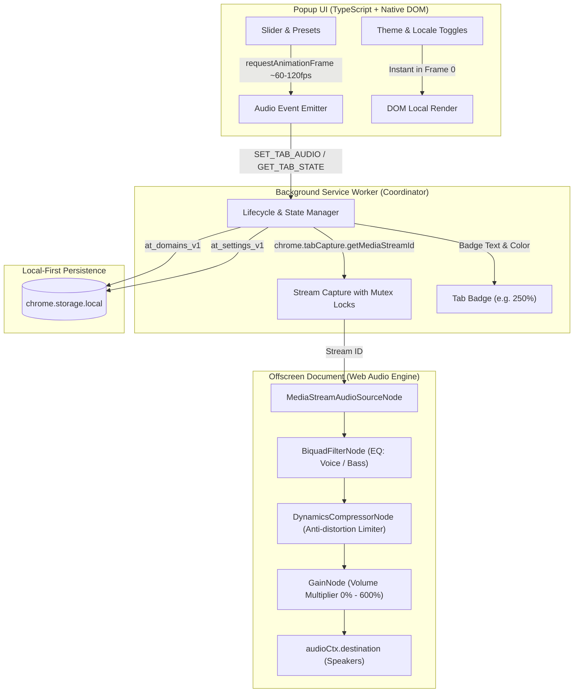

# Amplifier

Tab-level audio amplifier and studio equalizer that elevates volume up to **600%** with a dynamic anti-distortion limiter, one-click acoustic tone presets, and persistent per-website volume memory.

## Why This Extension

- Many recorded lectures, video streams, podcasts, and remote conferences suffer from low audio levels that remain inaudible even with system volume at 100%.
- Generic volume boosters frequently cause harsh digital distortion, buzzing, and clipping artifacts when boosting above standard levels.
- Conventional extensions require manual adjustments every time a new tab is opened on the same website.
- **Amplifier** solves this through a robust Chrome Manifest V3 architecture combining `tabCapture`, an offscreen Web Audio API pipeline with `DynamicsCompressorNode`, 4 studio tone presets, and 100% local persistence per domain.

## Key Features

- **0% to 600% Amplification:** Precision slider control, fine-tuned keyboard steps, and instant jump presets (100%, 200%, 300%, 600%).
- **Anti-Distortion Limiter:** Calibrated `DynamicsCompressorNode` prevents harsh clipping and audio saturation when exceeding 100%.
- **4 Studio Tone Presets:**
  - **Normal:** Flat, transparent response.
  - **Voice:** Vocal intelligibility boost (+9dB @ 2.4 kHz) optimized for speech, podcasts, and courses.
  - **Bass:** Deep low-frequency reinforcement (+11dB @ 110 Hz) for music and cinema.
  - **Night:** Dynamic range compression for balanced night-time listening without sudden volume spikes.
- **Automatic Per-Site Memory:** Automatically remembers custom volume levels and tone presets per domain (e.g. `youtube.com`) in `chrome.storage.local`.
- **Multi-Tab Audio Manager:** Inspects all background tabs playing sound in real time, allowing one-click muting or tab switching.
- **Acoustic Slate Palette (Light & Dark):** Inspired by analog studio audio hardware with cold slate surfaces, matte terracotta accents (`#E05A47`), a 12-segment responsive VU meter, and tabular numbers for zero layout jitter.
- **Canonical 6-Locale System with Vector Flags:** Native translations in English, Spanish, Brazilian Portuguese, French, German, and Japanese.

## System Architecture (Manifest V3 + Web Audio API)

Amplifier implements a decoupled architecture to satisfy the process isolation model of **Chrome Manifest V3**, where background service workers lack direct access to DOM audio APIs:



### Engineering Highlights (Portfolio Reference)

1. **Anti-Clipping Audio Processing Pipeline:**  
   Rather than applying a naive multiplicative gain that destroys audio clarity, Amplifier chains a calibrated `DynamicsCompressorNode` (`threshold: -24dB`, `ratio: 12`, `attack: 0.003s`, `release: 0.25s`) immediately prior to the `GainNode`. This allows boosting signals up to 6x while preserving dynamic clarity and preventing speaker clipping.

2. **Frame 0 Execution & Real-Time Responsiveness:**  
   - Audio contexts are initialized with `latencyHint: 'interactive'` and employ 5ms exponential ramps (`gain.setTargetAtTime`) to eliminate acoustic clicks and pops during volume transitions.
   - Slider dragging synchronizes through `requestAnimationFrame`, sending gain updates directly through a fast-path without blocking the user interface.
   - The offscreen document is proactively prewarmed upon popup launch to eliminate the initial 1-second cold-start delay on first boost.

3. **Concurrency Mutex for `tabCapture`:**  
   Chrome rejects redundant capture calls on active streams (`Cannot capture a tab with an active stream`). Amplifier manages an asynchronous per-tab mutex map (`tabCaptureLocks`) with execution queues and clean teardown auto-retries, handling rapid slider adjustments without service worker collisions.

4. **100% Local-First & Zero-Telemetry:**  
   Contains zero remote network requests, analytics trackers, or third-party SDKs. All website preferences (`at_domains_v1`) and user configurations (`at_settings_v1`) reside strictly in `chrome.storage.local`.

## Keyboard Shortcuts

- **Configurable Shortcut:** Click **Add shortcut** in the popup footer to configure your preferred key combination in `chrome://extensions/shortcuts` (Default: `Alt+Shift+A`).
- **Within the Popup:**
  - `←` / `→` or `↓` / `↑`: Fine volume adjustment (±5%).
  - `Shift + ←` / `Shift + →`: Coarse volume adjustment (±25%).
  - `M`: Toggle mute / restore previous volume.
  - `R`: Reset volume to 100% and normal preset.
  - `1`, `2`, `3`, `4`: Instant tone preset selection (Normal, Voice, Bass, Night).

## Tech Stack

| Category | Technology | Version | Purpose |
|---|---|---|---|
| Extension Framework | WXT | 0.21.5 | Build system, MV3 manifest generation, development HMR |
| Language | TypeScript | 5.9.3 | Strict static typing across all modules |
| Bundler | Vite | 8.3.8 | Fast bundling and tree-shaking |
| Platform | Chrome Extension Manifest V3 | - | TabCapture, Offscreen Document |
| Audio Engine | Web Audio API | - | GainNode, BiquadFilterNode, DynamicsCompressorNode |
| Storage | chrome.storage.local | - | 100% local persistence, zero backend |
| Testing | Vitest + jsdom | 5.1.1 / 31.0.1 | Unit test suites for pure logic modules |
| Asset Icons | @wxt-dev/auto-icons | 2.0.0 | Multi-resolution icon generation from source SVG |
| User Interface | Native DOM + TypeScript | - | Zero component framework overhead |

## Developer Installation

1. Install monorepo dependencies and compile the extension:
   ```bash
   pnpm install
   pnpm --filter amplifier run build
   ```
2. Navigate to `chrome://extensions/` in Google Chrome and enable **Developer mode** in the top-right corner.
3. Click **Load unpacked** (*Cargar descomprimida*).
4. Select the build output directory: `extensions/amplifier/.output/chrome-mv3`.

## Development Commands

```bash
# Run unit test suites
pnpm --filter amplifier test

# TypeScript type verification
pnpm --filter amplifier run compile

# Production build
pnpm --filter amplifier run build

# Package release .zip for Chrome Web Store
pnpm --filter amplifier run zip
```

## Privacy & Security

Amplifier operates **100% locally in your browser**. It makes zero outbound network requests, gathers no telemetry or analytics, and processes audio streams strictly on your local machine.

Read the complete multilingual policy at:  
👉 [**PRIVACY_POLICY.md**](PRIVACY_POLICY.md)

## Support & Issue Reporting

For bug reports, questions, or feature requests:
- **GitHub Issue Tracker:** [github.com/Beto18v/browser-extensions/issues](https://github.com/Beto18v/browser-extensions/issues)
- **Direct Developer Email:** [nicolasalbertov18@gmail.com](mailto:nicolasalbertov18@gmail.com)

## License & Author

Distributed under the [MIT License](LICENSE).

Authored by **[Nicolas Valenzuela](https://nival.is-a.dev)** (*Beto18v*).
- **Portfolio:** [nival.is-a.dev](https://nival.is-a.dev)
- **GitHub:** [github.com/Beto18v](https://github.com/Beto18v)
- **LinkedIn:** [linkedin.com/in/beto18v](https://www.linkedin.com/in/beto18v)
